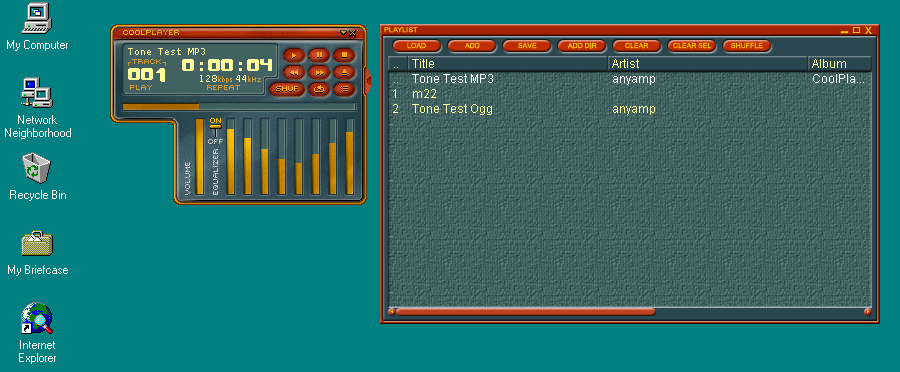

# CoolPlayer 2.19 for Windows NT 4.0

CoolPlayer is an MP3 and Ogg Vorbis player with skins, by Niek Albers and
others (see [Authors](#authors)). This tree builds CoolPlayer 2.19 for
Windows NT 4.0 on x86, MIPS, Alpha AXP and PowerPC, and for PINT 4.0 (Windows
NT 4.0 on 32-bit ARM, for the Raspberry Pi), from one source and one Makefile.

## Source

- The base is the CoolPlayer 2.19 source, `CoolPlayer219_Src.zip` (June 2008),
  from [SourceForge](https://sourceforge.net/projects/coolplayer/files/Coolplayer%20Source/219/).
- CoolPlayer project page: <https://sourceforge.net/projects/coolplayer/>
- The first commit in this repository is that zip, unchanged, without its CVS
  folders. The commits after it are this port.

## Programs

Get them from the [latest release](https://github.com/tenox7/coolplayer/releases/latest):

| File | CPU | Bytes |
|---|---|---|
| `coolplayer-x86-nt40.exe` | x86 | 637,440 |
| `coolplayer-mips-nt40.exe` | MIPS R4000 | 982,528 |
| `coolplayer-axp-nt40.exe` | Alpha AXP | 856,064 |
| `coolplayer-ppc-nt40.exe` | PowerPC | 828,928 |
| `coolplayer-arm-pint40.exe` | ARM (PINT 4.0) | 630,272 |

- Each program is one file. The default skin is inside it.
- They use only DLLs that NT 4.0 has: KERNEL32, USER32, GDI32, COMDLG32,
  ADVAPI32, SHELL32, OLE32, COMCTL32 and WINMM. The C runtime is static (`-MT`).
- Subsystem version 4.00 (NT 4.0).
- Settings go to `coolplayer.ini`, in the folder of the program.

## Build

On NT 4.0, with Visual C++ 4.x for the CPU and the Win32 SDK of 1996:

    xcopy X:\coolplayer\*.* cp /s /e
    cd cp
    nmake

- `X:\coolplayer` is this tree, for example on a network share.
- The result is `coolplayer.exe`. `nmake clean` deletes what nmake made.
- Build on a local disk. Close CoolPlayer before you link again: NT locks a
  running program.
- macOS can set its "hidden" flag on files. NT then sees them as hidden, and
  xcopy does not copy them. Before you copy, run `chflags -R nohidden .` in
  this tree on the Mac.

For PINT 4.0 (ARM), use the PINT 4.0 SDK in Docker, in this tree:

    docker run --rm -v msvc-arm32:/opt/msvc -v "$PWD":/src tenox7/pint40sdk nmake

- First install Microsoft C for ARM into the `msvc-arm32` volume once, as the
  SDK's README says (`docker run --rm tenox7/pint40sdk` shows it).
- The SDK's `link` marks the program for NT 4.0.
- ARM needs no source change.

Compilers used for the release:

| CPU | cl | link | Where |
|---|---|---|---|
| x86 | 10.20 (Visual C++ 4.2) | 4.20 | `tenox7/nt40sdk` Docker image |
| MIPS | 10.00.6081 (Visual C++ 4.0) | 3.10.6053 | lab VM nt40mips |
| Alpha | 10.10.6079 (Visual C++ 4.1) | 3.10.6038 | lab VM nt40axp |
| PowerPC | 10.10.6101 (Visual C++ 4.1) | 3.10.6083 | lab VM nt40ppc |
| ARM | 19.44.35229 (Microsoft C for ARM 14.44) | 14.44.35229 | `tenox7/pint40sdk` Docker image |

## Makefile flags

- All CPUs: `-Ox -MT`.
- MIPS: `-Og-`. With `-Og`, Visual C++ for MIPS crashes and makes wrong code.
- Alpha: `-QAieee1`. Then NT can give the IEEE result for 0/0, NaN and
  denormal numbers, as the other CPUs do.
- zlib, all CPUs: `-Og-`. With `-Og`, Visual C++ 4.2 for x86 makes a bad
  `inflate.c`. Then 5 of the 27 skin files do not unpack, and CoolPlayer stops
  at start with an access violation. zlib only unpacks the skin. Microsoft C
  for ARM warns that `-Og-` is deprecated (D9035). The warning does no harm.
- libmad: `-DFPM_DEFAULT -DASO_ZEROCHECK -DHAVE_CONFIG_H`, as in upstream's
  `mad.dsp`.

## Changes from CoolPlayer 2.19

Made in November 2026. The git history has each change.

### Removed

- `CPI_Player_Output_DirectSound.c`. NT 4.0 on MIPS and PowerPC, and NT 3.x,
  have no DSOUND.DLL. A program that links `dsound.lib` does not start there.
- The Visual C++ 6 project files (`*.dsw`, `*.dsp`) and the CVS folders. The
  `Makefile` replaces the project files.

### Old headers and NT 4.0 DLLs

- `stdafx.h`: `_WIN32_WINNT 0x0400`. Fallback defines for `WM_MOUSEWHEEL`,
  `ICON_SMALL`, `ICON_BIG` and `BIF_EDITBOX`. No `wininet.h`.
- `WindowsOS.h`: `TRACKMOUSEEVENT`, `TME_LEAVE` and `WM_MOUSELEAVE`, if the
  headers do not have them. The RISC kits have the Visual C++ 4.x headers of 1995.
- `WindowsOS.c`, `WindowsOS.h`, `CPI_Playlist.c`, `CPI_Stream_Internet.c`:
  WININET.DLL loads when CoolPlayer first needs it (`CP_LoadWinInet`). NT 4.0
  gets WININET.DLL only with Internet Explorer, and the 1996 SDK has no
  `wininet.lib`. Without WININET.DLL, internet streams do not open. All else works.
- `main.c`: `InitCommonControls`, not `InitCommonControlsEx`. NT 4.0 has
  COMCTL32 4.00. `InitCommonControlsEx` needs 4.70 (Internet Explorer 3).
- `coolplayer.rc`: `windows.h` and `commctrl.h`, not MFC's `afxres.h`.
- `debug.h`: `DebugBreak()`, not x86 `__asm int 3` (debug builds only).
- `mad/mad.h`: `FPM_DEFAULT`, not `FPM_INTEL` (x86 assembler). Upstream built
  the library with `FPM_DEFAULT` already, so the header now agrees with it. The
  MP3 sound does not change.
- `vorbis/os.h`: the x86 assembler `vorbis_ftoi` only on x86 (`_M_IX86`). The
  other CPUs use the C version, with the rounding fix from libvorbis 1.3
  (`floor`). Without that fix, each negative sample came out 1 too high.

### MIPS, Alpha and PowerPC

- `CompositeFile.c`, `CPI_PlaylistItem.c`: no 32-bit reads or writes at
  unaligned addresses. These are in the skin zip reader and in the Ogg comment
  reader and writer.
- `CPI_Image.c`: a skin bitmap has its BITMAPINFO at file offset 14, which is
  not 4-aligned. CoolPlayer now copies it to an aligned buffer. Before, NT on
  MIPS stopped the program here (STATUS_DATATYPE_MISALIGNMENT).
- `skin.c`: no 0/0 for the position slider before the first skin loads (two
  places). Before, NT on Alpha stopped the program with "Floating-point
  invalid operation".

### Changed behavior

- The output setting has a new ini key: `Output` (0 = WaveOut, 1 = File).
  Upstream used `Outputmode` (0 = WaveOut, 1 = DirectSound, 2 = File). An old
  ini file gives WaveOut.
- With `Output=1` (File), CoolPlayer now starts on a computer that has no sound
  device. Before, it always stopped with "No audio devices in this system".
  With WaveOut, it still stops.

## Tests

NT 4.0 in QEMU VMs (PINT 4.0: the PINT 4.0 release of 2026-11-19 on QEMU
raspi2b), with File output:

| Test | x86 | MIPS | Alpha | PowerPC | ARM |
|---|---|---|---|---|---|
| Start, default skin, playlist window | ok | ok | ok | ok | ok |
| MP3, 44.1 kHz stereo | ok | ok | ok | ok | ok |
| MP3, 22 kHz mono (MPEG-2) | ok | ok | ok | ok | ok |
| Ogg Vorbis | ok | ok | ok | ok | ok |
| Equalizer | not tested | ok | ok | ok | ok |
| Exit (Esc) | ok | ok | ok | ok | ok |
| WaveOut | no device | no device | no device | no device | plays, no sound in QEMU |

- MP3: the WAV output is bit-identical on the five CPUs. It has 61 dB SNR
  against ffmpeg's decoder. This is libmad `FPM_DEFAULT`, as in upstream.
- CoolPlayer's MP3 dither keeps its state from one file to the next. To
  compare outputs, play the same files in the same order in one run. These
  tests used `coolplayer.exe t.mp3 m22.mp3 o.ogg`.
- Ogg: the CPUs differ by at most 1 LSB, on 0.1 % of the samples (floating
  point). ARM gives the same output as MIPS and Alpha. 83 dB SNR against ffmpeg
  on the left channel. The right channel of the test file is bad in both
  decoders: it comes from ffmpeg's experimental Vorbis encoder.
- Equalizer: bit-identical on MIPS, Alpha, PowerPC and ARM.
- WaveOut on PINT 4.0 in QEMU: CoolPlayer opens the device and plays, about 2
  times faster than real time, with no sound.
- Also seen working: ID3 and Ogg titles in the playlist, the Options dialog
  and the tray menu.

To test with no sound device, put this `coolplayer.ini` next to the program:

    [Misc]
    Output=1

For each file, CoolPlayer then shows a Save As dialog and writes `<name>.wav`.
If Enter does nothing in the dialog, click its title bar first.

Not tested:

- WaveOut with real sound. No lab VM has a working sound device. nt40ppc has
  a CS4231A chip, but NT 4.0 has no driver for it.
- Internet streams. They need the network.
- Skins from files. Only the default skin was used.
- Real hardware, also a real Raspberry Pi.

## Known issues

- Upstream: at the end of an MP3, CoolPlayer drops the last 32 KB output block
  that is not full (`CPI_Player_CoDec_MPEG.c`, `return FALSE` at end of file).
  Up to about 0.2 s at 44.1 kHz stereo is lost; 0.16 s with the test file.
  WaveOut uses the same code. This port does not change it.
- Upstream: with File output, the WAV header of an MP3 gives the full length,
  but the file does not have the lost block. NT's Sound Recorder then says
  that the file is corrupted.
- On an 8-bit display (the MIPS and PowerPC VMs), the skin looks dithered.
- Alpha in lemu: 0/0 stops the program even with `-QAieee1` and all
  floating-point exceptions masked. NT's software completion seems not to
  work in the emulator. The `skin.c` change removes the only 0/0 that we found.
  Test on a real Alpha.

## Next

- NT 3.51 and NT 3.1.
- WaveOut on real hardware, also PINT 4.0 on a Raspberry Pi.

## Authors

CoolPlayer, as its About box (`coolplayer/res/about.txt`) gives them:

- Niek Albers: project manager, original program, DirectSound output
- Marcus Platts: project manager, player engine rewrite, input and output
  modules, Cooler Wave Mapper
- Rob Leslie: MAD MPEG audio decoder
- Joel Klinghed: Ogg Vorbis input module
- Dmitry Vassiliev: 8-band equalizer
- Andrew Paterson: changes for build 216
- Erukian and Infinil: website design
- Rutger-Jan Hoogerdijk: default skin
- Eric "Rix" Allard: changes
- Richard Hopkins: changes

The libraries in this tree:

- libmad 0.15.1b: Robert Leslie, Underbit Technologies
- libogg and libvorbis 1.2.0: Xiph.Org Foundation
- zlib 1.2.3: Jean-loup Gailly and Mark Adler

## License

CoolPlayer is free software under the GNU General Public License, version 2
or (at your option) any later version. The license text is in `COPYING`. This
port has the same license.

| Part | Folder | License | Copyright |
|---|---|---|---|
| CoolPlayer 2.19 | `coolplayer` | GPL 2 or later, `COPYING` | 2000-2006 Niek Albers |
| libmad 0.15.1b | `mad` | GPL 2 or later, `COPYING` | 2000-2004 Underbit Technologies, Inc. |
| libogg | `ogg` | BSD-style, `ogg/COPYING` | 1994-2007 Xiph.Org Foundation |
| libvorbis 1.2.0 | `vorbis` | BSD-style, `vorbis/COPYING` | 1994-2007 Xiph.Org Foundation |
| zlib 1.2.3 | `zlib` | zlib license, at the top of `zlib/zlib.h` | 1995-2005 Jean-loup Gailly and Mark Adler |

The 2.19 zip has no license files. `COPYING`, `ogg/COPYING` and
`vorbis/COPYING` come unchanged from the CoolPlayer 2.16 source, the last
release that had them.
